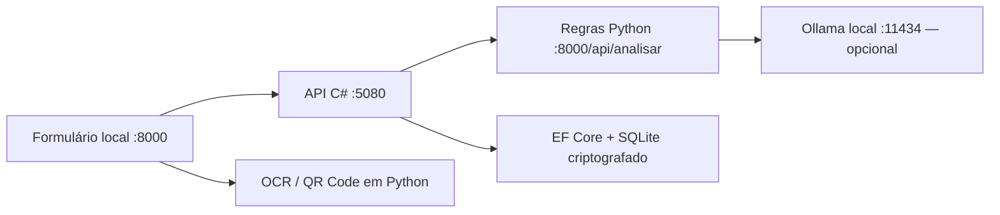

# Executar o projeto completo

## Componentes



Os endereços internos são fixos no loopback. As chamadas entre API e processador levam um token gerado pelo iniciador, que não é salvo no Git nem enviado ao navegador. A API recusa iniciar sem token. Os clientes internos não utilizam proxy nem seguem redirecionamentos.

## Instalação

1. Instale Python 3.11+ e execute `scripts/configurar.ps1`.
2. Instale o [SDK .NET 10](https://dotnet.microsoft.com/download/dotnet/10.0). O iniciador também reconhece uma instalação portátil em `.tools/dotnet`.
3. Execute `scripts/iniciar-completo.ps1`.

O script compila a API, inicia o serviço C# em segundo plano e abre a interface Python. Ctrl+C encerra os processos iniciados pelo script. O script `iniciar.ps1` continua disponível para executar somente Python.

## IA local

Instale o [Ollama para Windows](https://ollama.com/download/windows) ou disponibilize o pacote portátil em `.tools/ollama`. Execute `scripts/iniciar-ia.ps1` em um terminal separado. O script desativa os recursos cloud e guarda os modelos em `.tools/models`, ignorado pelo Git.

Com o servidor ativo, execute uma vez em outro terminal:

```powershell
ollama pull qwen2.5:0.5b
```

Se estiver usando o pacote portátil, substitua `ollama` por `.\.tools\ollama\ollama.exe`. O download do modelo requer internet. As inferências usam `127.0.0.1:11434`. Marque **Adicionar explicação com IA local** ao analisar. Não é necessário baixar modelo para executar os testes automatizados.

O cliente aceita somente `qwen2.5:0.5b`, consulta seus metadados locais e rejeita um modelo com indicação de host remoto. Envia apenas títulos de alertas, recomendações genéricas, nível e pontuação. Textos originais, nomes, URLs, chaves Pix e evidências não entram no prompt. O modelo não tem ferramentas, acesso ao banco ou poder de mudar a pontuação. A saída é texto escapado pelo template, identificada como gerada e sujeita a erro. Falhas do motor aparecem como aviso e não impedem o relatório das regras.

O modelo pequeno facilita a execução em CPU, com qualidade limitada. Não há alegação de precisão clínica, bancária ou de detecção de fraude. A saída generativa deve ser revisada.

Referência do protocolo: [Ollama Generate](https://docs.ollama.com/api/generate) e [modo local](https://docs.ollama.com/faq).

## Histórico

O modo Python mantém seu histórico Fernet existente. O modo completo usa `%LOCALAPPDATA%/ConfereAntes/api/historico.db`, criado por EF Core, e um diretório `keys` do Data Protection. Os dois históricos são independentes, identificados pelo modo de execução; não há migração automática. A API protege o conteúdo antes de persistir e só salva quando solicitado. A chave no mesmo perfil não protege contra alguém que controla a conta local. A explicação generativa não é guardada no histórico.

## QR Code

Abra a seção complementar e selecione uma imagem no campo QR Code. O decoder ZXing lê o símbolo, sem abrir links. Um conteúdo com prefixo Pix vai ao campo Pix; outro conteúdo vai ao campo de endereço para revisão. Imagens com múltiplos códigos são recusadas para evitar escolher um destinatário arbitrariamente. Os limites de tipo, tamanho, resolução e comprimento são verificados antes da análise.

## Testes

```powershell
.\.venv\Scripts\python.exe -m pytest -q
dotnet test api/ConfereAntes.Api.Tests
```

Os testes C# usam SQLite real e um processador HTTP simulado. O teste integrado dos dois serviços usa evidências fictícias. Os testes de IA simulam o protocolo para verificar isolamento e falhas; não avaliam estatisticamente a qualidade do modelo.

Uma evolução de esquema persistente deve usar migrations EF Core; a versão atual cria o esquema inicial por `EnsureCreated`.
