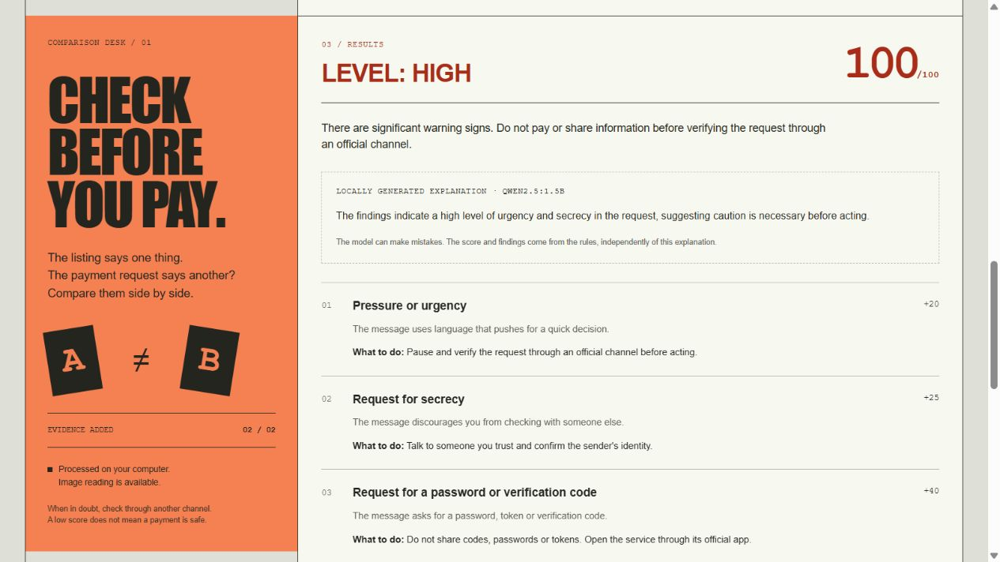

# ConfereAntes

[Português](README.md) · [English](README.en.md)

ConfereAntes is a local tool for reviewing a payment request before making a Pix payment. It compares the original offer with the message you received and points out differences in amounts, recipients, addresses and Pix codes.

Its score comes from visible rules. The score helps organize a review; it does not prove that a request is legitimate or fraudulent.



## Start

Requires Python 3.11 or later on Windows.

```powershell
git clone https://github.com/caio-vasconcellos/confereantes.git
cd confereantes
python -m venv .venv
.\.venv\Scripts\python.exe -m pip install -e ".[ocr]"
.\.venv\Scripts\python.exe -m confereantes.cli
```

Open `http://127.0.0.1:8000` if the browser does not open automatically. This mode already includes the rules, OCR, QR-code reading, local history and optional AI explanations. You do not need .NET to use the app.

If your Python installation does not include `venv`, install `virtualenv` with `python -m pip install virtualenv` and use `python -m virtualenv .venv` for the first line. The `setup.ps1` and `start.ps1` scripts are shortcuts for setup and launch.

## What it checks

- Brazilian real amounts and recipient names;
- urgency, secrecy, password requests and remote-access requests;
- unusual addresses, without opening the submitted link;
- Pix copy-and-paste structure and CRC;
- screenshot text with local OCR;
- QR-code content shown for review before any action;
- empty fields, oversized text, malformed links and invalid Pix codes.

History is stored only when you select that option. Reports can be printed or saved as PDF through the browser.

## Optional features

### C# API and EF Core

The command below replaces the Python history with an ASP.NET Core API backed by EF Core and SQLite. This is a study integration; Python still calculates the rule results.

```powershell
.\scripts\start-full.ps1
```

This mode requires the .NET 10 SDK. The two modes keep separate histories.

### Local-model explanation

With [Ollama](https://ollama.com/download/windows) installed, start the server in one terminal:

```powershell
.\scripts\start-ai.ps1
```

In another terminal, download the model once:

```powershell
ollama pull qwen2.5:1.5b
```

The model receives finding labels, generic recommendations, the level and the score; it does not receive original messages, names, links or Pix keys. Its explanation may be wrong and never changes the score.

## Development

```powershell
.\.venv\Scripts\python.exe -m pip install -e ".[dev]"
.\.venv\Scripts\python.exe -m pytest -q
node --test tests/frontend.test.cjs
dotnet test api/ConfereAntes.Api.Tests
```

The C# test is only needed when changing the optional integration. The end-to-end test is `scripts/smoke_completo.py` and uses ports 8000 and 5080.

## More details

- [How the project works](docs/HOW-IT-WORKS.md)
- [Security and privacy](docs/SECURITY-AND-PRIVACY.md)
- [Change history (Portuguese)](CHANGELOG.md)
