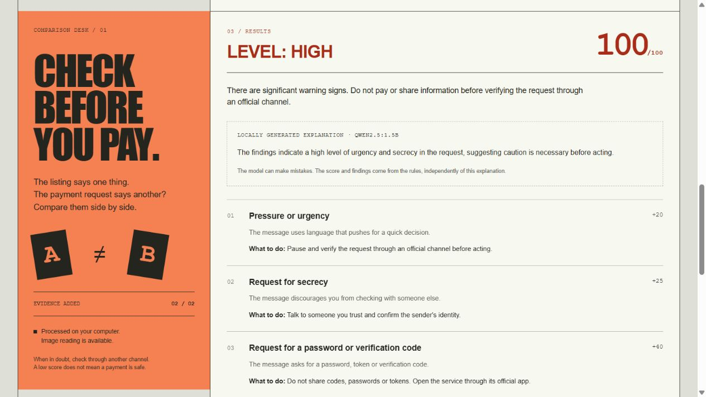

# ConfereAntes

[English](README.md) · [Português](README.pt-BR.md)

A local tool for checking a message or payment request before making a Pix payment. Compare the original offer with the message you received, review differences in amounts and recipients, and see which details need another check.

ConfereAntes uses deterministic rules for its score. An optional local model can explain the findings; it does not decide whether a payment is safe.



## Features

- Compare offer and payment-request text side by side.
- Extract text from screenshots with local OCR.
- Read QR codes into a field you can review, without opening their content.
- Flag urgency, secrecy, credential requests, remote access and unusual links.
- Compare Brazilian real amounts and recipient names.
- Parse Pix copy-and-paste codes and check their CRC checksum.
- Save selected analyses to encrypted local history.
- Print a report or save it as PDF through the browser.
- Use the interface, reports and optional explanations in English or Portuguese.

Pix is Brazil's instant payment system. The English interface still handles Pix codes and Brazilian amounts such as `R$ 1.850,00`. It does not convert currencies.

## Architecture

| Component | Purpose |
| --- | --- |
| Python / FastAPI | Web interface, rule engine, OCR and QR decoding |
| ASP.NET Core / C# | Analysis orchestration and history API |
| EF Core / SQLite | Encrypted history in full mode |
| Ollama / Qwen 2.5 1.5B | Optional explanations on the same computer |

The web interface runs at `http://127.0.0.1:8000`. Full mode adds the C# API on port 5080. Ollama uses port 11434. The services bind to loopback by default.

## Quick start — Windows

Requires Python 3.11 or later. Full mode also requires the .NET 10 SDK.

```powershell
git clone https://github.com/caio-vasconcellos/confereantes.git
cd confereantes
Set-ExecutionPolicy -Scope Process Bypass
.\scripts\setup.ps1
.\scripts\start-full.ps1
```

For Python-only mode, use `.\scripts\start.ps1`. This mode has its own history and does not need .NET.

The English launchers select English. You can change the language at the top of either page; the preference lasts for the browser session. The Portuguese launchers remain available under their original names.

### Optional local explanations

Install Ollama, then start it with:

```powershell
.\scripts\start-ai.ps1
```

In another terminal, download the model once:

```powershell
ollama pull qwen2.5:1.5b
```

For the portable installation, use `.\.tools\ollama\ollama.exe` instead of `ollama`. Select the local-explanation option in the form. The first request may take up to three minutes while the model loads.

Ollama receives finding labels, generic recommendations, the risk level and score. It does not receive the original messages, names, links or Pix keys. Evidence is not sent to an external analysis service.

## Try it

Click **Try an example** to fill in a fictional listing and payment request. Run the check, then inspect the reasons behind the score. You can also upload an offer screenshot or a QR-code image.

The language setting changes the interface, not your evidence. Messages stay exactly as entered. The rule set recognizes selected warning phrases in Portuguese and English.

## Development

```powershell
python -m venv .venv
.\.venv\Scripts\Activate.ps1
python -m pip install -e ".[ocr,dev]"
confereantes --lang en
```

Tests:

```powershell
python -m pytest -q
node --test tests/frontend.test.cjs
dotnet test api/ConfereAntes.Api.Tests
python scripts/smoke_completo.py --lang en
```

The smoke test starts real services with an isolated database. Keep ports 8000 and 5080 free. Add `--with-ai` when Ollama and the model are running. GitHub Actions checks Python, JavaScript, C# and both interface languages.

## Project structure

```text
src/confereantes/      FastAPI app, rules, OCR, QR, localization and local-model client
api/                  ASP.NET Core API and integration tests
scripts/              Windows launchers and end-to-end smoke test
tests/                Python and JavaScript tests
docs/                 English documentation and screenshots
```

## Limits and privacy

The score is a collection of warning rules, not a fraud probability. A low score does not prove a request is legitimate. OCR, approximate name matching and model explanations can be wrong.

CRC checks code integrity, not ownership of a Pix key or the recipient's legitimacy. ConfereAntes does not query banks or domain-reputation services and does not make payments.

History is off by default. Python-only and full mode keep separate databases; there is no automatic migration. Keys stay in the same local profile, so encryption does not protect against someone who controls that account. Upload handling may use temporary local files. Do not commit real evidence to Git.

## Documentation

- [Architecture and setup](docs/en/ARCHITECTURE.md)
- [Privacy](docs/en/PRIVACY.md) and [security](docs/en/SECURITY.md)
- [Demo walkthrough](docs/en/DEMO.md)
- [Design notes](docs/en/DESIGN.md)
- [Review notes](docs/en/REVIEW.md) and [validation record](docs/en/DELIVERY.md)
- [Changelog](docs/en/CHANGELOG.md)

Author: Caio Pires Vasconcellos.
