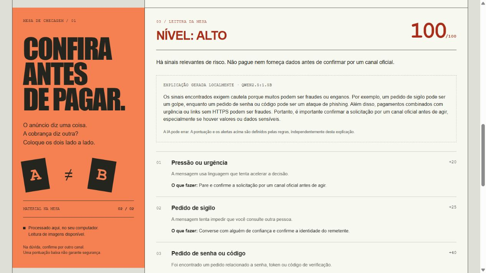

# ConfereAntes

[Português](README.md) · [English](README.en.md)

O ConfereAntes é uma ferramenta local para revisar uma cobrança antes de fazer um Pix. Ele compara o anúncio com a mensagem recebida e destaca diferenças de valor, destinatário, endereço e código Pix.

A pontuação vem de regras visíveis. Ela ajuda a organizar a conferência, mas não prova que uma cobrança é verdadeira ou falsa.



## Começar

Requer Python 3.11 ou mais recente no Windows.

```powershell
git clone https://github.com/caio-vasconcellos/confereantes.git
cd confereantes
python -m venv .venv
.\.venv\Scripts\python.exe -m pip install -e ".[ocr]"
.\.venv\Scripts\python.exe -m confereantes.cli
```

Acesse `http://127.0.0.1:8000` se o navegador não abrir sozinho. Esse modo já oferece regras, OCR, leitura de QR Code, histórico local e a explicação opcional por IA. Não é preciso instalar .NET para usar o aplicativo.

Se o Python não incluir `venv`, instale `virtualenv` com `python -m pip install virtualenv` e use `python -m virtualenv .venv` na primeira linha. Os scripts `configurar.ps1` e `iniciar.ps1`, na pasta `scripts`, são atalhos para a instalação e a abertura.

## O que ele confere

- valores em reais e nomes de destinatários;
- sinais de urgência, sigilo, pedido de senha ou acesso remoto;
- endereços incomuns, sem abrir o link informado;
- estrutura e CRC do Pix copia e cola;
- texto de capturas com OCR local;
- conteúdo de um QR Code, exibido para revisão antes de qualquer ação;
- campos vazios, textos longos, links quebrados e códigos Pix inválidos.

O histórico só é salvo quando a opção correspondente é marcada. O relatório pode ser impresso ou salvo em PDF pelo navegador.

## Recursos opcionais

### API C# e EF Core

O script abaixo troca o histórico Python por uma API ASP.NET Core com EF Core e SQLite. É uma integração de estudo; o resultado das regras continua sendo calculado em Python.

```powershell
.\scripts\iniciar-completo.ps1
```

Esse modo requer o SDK .NET 10. Os dois modos mantêm históricos separados.

### Explicação com modelo local

Com o [Ollama](https://ollama.com/download/windows) instalado, inicie o servidor em um terminal:

```powershell
.\scripts\iniciar-ia.ps1
```

Em outro terminal, baixe o modelo uma vez:

```powershell
ollama pull qwen2.5:1.5b
```

O modelo recebe os nomes dos alertas, recomendações genéricas, nível e pontuação; não recebe os textos originais, nomes, links ou chaves Pix. A explicação pode errar e nunca altera a pontuação.

## Desenvolvimento

```powershell
.\.venv\Scripts\python.exe -m pip install -e ".[dev]"
.\.venv\Scripts\python.exe -m pytest -q
node --test tests/frontend.test.cjs
dotnet test api/ConfereAntes.Api.Tests
```

O teste C# só é necessário ao alterar a integração opcional. O teste de ponta a ponta está em `scripts/smoke_completo.py` e usa as portas 8000 e 5080.

## Mais detalhes

- [Como o projeto funciona](docs/COMO-FUNCIONA.md)
- [Segurança e privacidade](docs/SEGURANCA-E-PRIVACIDADE.md)
- [Histórico de mudanças](CHANGELOG.md)
