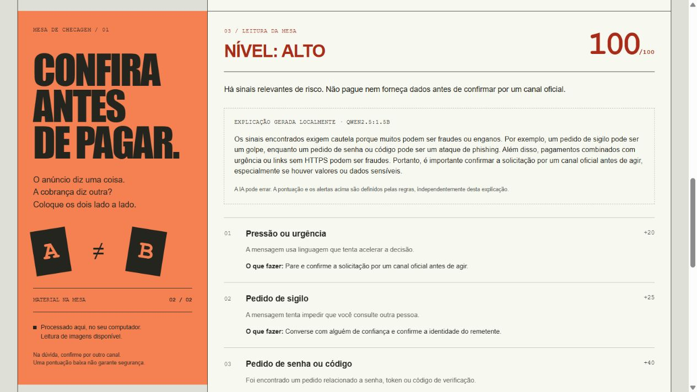

# ConfereAntes

[English](README.md) · [Português](README.pt-BR.md)

Ferramenta local para conferir uma mensagem ou cobrança antes de fazer um Pix. Compare o anúncio original com o que chegou na conversa e veja diferenças de valor, destinatário e outros detalhes que precisam de confirmação.

A pontuação vem de regras determinísticas. Um modelo local pode explicar os alertas, mas não decide se um pagamento é seguro.



## Funcionalidades

- Comparação de anúncio e cobrança lado a lado.
- OCR local para extrair texto de capturas.
- Leitura de QR Code, com revisão do conteúdo sem abrir links.
- Alertas de urgência, sigilo, credenciais, acesso remoto e links incomuns.
- Comparação de valores em reais e nomes de destinatários.
- Leitura do Pix copia e cola e verificação de integridade CRC.
- Histórico local criptografado, salvo apenas quando solicitado.
- Impressão do resultado ou PDF pelo navegador.
- Interface, relatórios e explicações opcionais em português e inglês.

## Arquitetura

| Componente | Função |
| --- | --- |
| Python / FastAPI | Interface web, regras, OCR e QR Code |
| ASP.NET Core / C# | Orquestração das análises e API de histórico |
| EF Core / SQLite | Histórico criptografado no modo completo |
| Ollama / Qwen 2.5 1.5B | Explicações opcionais no próprio computador |

A interface fica em `http://127.0.0.1:8000`. O modo completo usa a API C# na porta 5080; o Ollama usa a 11434. Os serviços escutam no loopback por padrão.

## Instalação no Windows

Requer Python 3.11 ou superior. O modo completo também precisa do SDK .NET 10.

```powershell
git clone https://github.com/caio-vasconcellos/confereantes.git
cd confereantes
Set-ExecutionPolicy -Scope Process Bypass
.\scripts\configurar.ps1
.\scripts\iniciar-completo.ps1
```

Para usar somente Python, execute `.\scripts\iniciar.ps1`. Esse modo tem histórico próprio e dispensa o .NET.

O idioma pode ser alterado no topo da página. A preferência vale para a sessão do navegador. Os scripts `setup.ps1`, `start.ps1`, `start-full.ps1` e `start-ai.ps1` oferecem a inicialização em inglês.

### Explicação local opcional

Instale o Ollama e inicie:

```powershell
.\scripts\iniciar-ia.ps1
```

Em outro terminal, baixe o modelo uma vez:

```powershell
ollama pull qwen2.5:1.5b
```

Na instalação portátil, substitua `ollama` por `.\.tools\ollama\ollama.exe`. Marque a opção de explicação no formulário. A primeira solicitação pode levar até três minutos para carregar o modelo.

O modelo recebe somente rótulos de alertas, recomendações genéricas, nível e pontuação. Textos originais, nomes, links e chaves Pix não entram no prompt.

## Demonstração

Clique em **Testar com exemplo** para preencher uma oferta e cobrança fictícias. Confira o resultado e os motivos da pontuação. Também é possível enviar uma captura de oferta ou imagem de QR Code.

O idioma muda a interface, não as evidências. Os textos permanecem como foram inseridos. As regras reconhecem algumas expressões de alerta em português e inglês. Os valores continuam em reais, sem conversão de moeda.

## Desenvolvimento

```powershell
python -m venv .venv
.\.venv\Scripts\Activate.ps1
python -m pip install -e ".[ocr,dev]"
confereantes --lang pt
```

Testes:

```powershell
python -m pytest -q
node --test tests/frontend.test.cjs
dotnet test api/ConfereAntes.Api.Tests
python scripts/smoke_completo.py
```

O teste integrado usa serviços reais e banco isolado. Deixe as portas 8000 e 5080 livres. Acrescente `--with-ai` com Ollama e o modelo ativos, ou `--lang en` para conferir o fluxo em inglês. O GitHub Actions executa os testes nos dois idiomas.

## Estrutura

```text
src/confereantes/      FastAPI, regras, OCR, QR, tradução e cliente do modelo local
api/                  API ASP.NET Core e testes de integração
scripts/              Inicializadores Windows e teste de ponta a ponta
tests/                Testes Python e JavaScript
docs/                 Documentação em inglês e capturas
```

## Limites e privacidade

A pontuação representa regras de atenção, não probabilidade de fraude. Um resultado baixo não comprova legitimidade. OCR, comparação aproximada de nomes e explicações do modelo podem errar.

CRC verifica integridade do código, não titularidade da chave Pix ou legitimidade do destinatário. O aplicativo não consulta bancos ou reputação de domínios e não realiza pagamentos.

O histórico vem desligado. Os modos Python e completo mantêm bancos separados, sem migração automática. As chaves ficam no mesmo perfil local e não protegem contra quem já controla a conta. O recebimento de uploads pode usar arquivos temporários locais. Evidências reais não devem entrar no Git.

## Documentação

- [Arquitetura e instalação](ARQUITETURA.md)
- [Privacidade](PRIVACIDADE.md) e [segurança](SEGURANCA.md)
- [Roteiro de demonstração](DEMONSTRACAO.md)
- [Design](DESIGN.md)
- [Revisão](REVISAO.md) e [registro de validação](ENTREGA.md)
- [Histórico de versões](CHANGELOG.md)

Autor: Caio Pires Vasconcellos.
