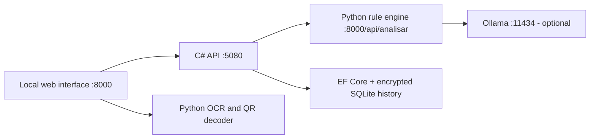

# Architecture

[English](ARCHITECTURE.md) · [Português](../../ARQUITETURA.md)

## Services

The Python-only launcher runs the interface and processing without C#. Full mode routes analyses through the C# API. Both modes keep working when the optional model is unavailable.

## Setup

Use Python 3.11+ and run `scripts/setup.ps1`. For full mode, install the .NET 10 SDK and run `scripts/start-full.ps1`. A portable SDK under `.tools/dotnet` is also supported. The launcher builds the API, starts it in the background and opens the interface. Ctrl+C stops the processes it started. Use `-NoBrowser` to skip opening the browser.

For Python-only mode, use `scripts/start.ps1` or `confereantes --lang en`.

## Internal requests

The launcher creates an ephemeral service token for calls between C# and Python. It is not written to Git or sent to the browser. The C# API refuses to start without a token of at least 32 characters. Internal clients use fixed loopback addresses, disable proxy use and do not follow redirects.

Browser forms and uploads use a separate CSRF token. A script calling interface routes must first load the page to obtain it. See `scripts/smoke_completo.py` for a working example.

The original route names and machine risk codes (`baixo`, `atencao`, `alto`) are kept for compatibility. Display labels are localized. Internal results are stored in their canonical language; history labels are translated when rendered. Evidence is never translated.

## Language

The UI supports `?lang=en` and `?lang=pt`. A valid choice is kept in an HTTP-only session cookie. The request header or launcher language is used when no choice has been saved. Forms carry their language to the C# API and Python processor. Concurrent requests use separate language contexts.

The catalog is in `src/confereantes/i18n.py`. English covers templates, upload messages, findings, validation errors, history and generated explanations. The JSON field `explicacao` remains the internal model-response key in both languages.

## Local model

Install Ollama or put its portable files under `.tools/ollama`. Run `scripts/start-ai.ps1`, then download `qwen2.5:1.5b` once with `ollama pull qwen2.5:1.5b`. The script disables cloud features and stores models in `.tools/models`.

The client only accepts the configured local model. It checks its metadata and rejects a remote host. The prompt contains finding titles, generic recommendations, level and score, not original messages, recipient names, links or Pix keys. Explanations are not stored in history.

The output must be JSON with a short explanation. Empty, malformed, truncated and some known unsafe outputs are discarded. This is a limited check, not a guarantee of factual correctness. The model has no tools, database access or ability to change the score.

References: [Ollama API](https://docs.ollama.com/api/generate), [local mode](https://docs.ollama.com/faq).

## Storage

Python-only mode uses Fernet and `%LOCALAPPDATA%/ConfereAntes/historico.sqlite3`. Full mode uses EF Core, `api/historico.db` and Data Protection keys in `api/keys`, under the same local data directory. The histories are independent, with no automatic migration.

The initial EF Core schema is created with `EnsureCreated`. Future schema changes should use migrations. Encryption keys in the same local profile do not protect against someone who controls that account.

## Image processing

OCR uses RapidOCR. QR decoding uses ZXing. Images are checked for file type, size and resolution; decoded content is checked for length. Multiple QR codes are rejected so the app does not choose a recipient on the user's behalf. QR contents are never opened.

## Tests

Run `python -m pytest -q`, `node --test tests/frontend.test.cjs` and `dotnet test api/ConfereAntes.Api.Tests`. The C# integration test uses real SQLite with a simulated Python HTTP processor. `python scripts/smoke_completo.py --lang en` exercises both real services with an isolated database. Add `--with-ai` with Ollama running.
